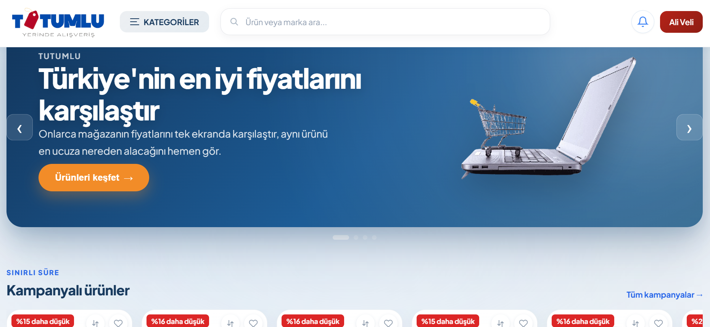
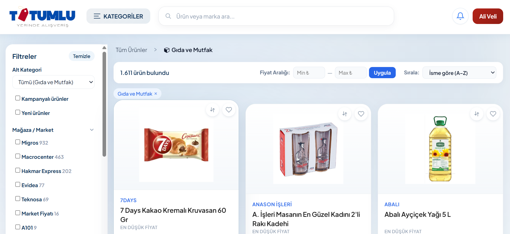
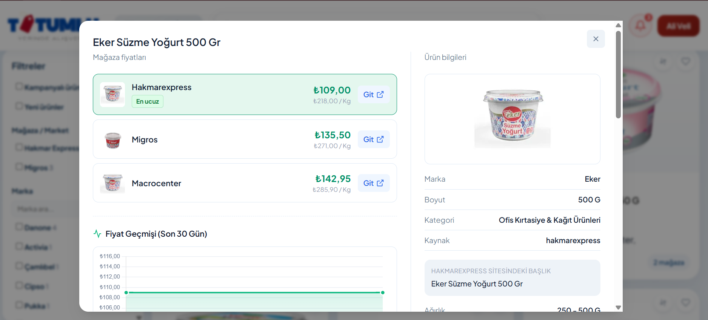
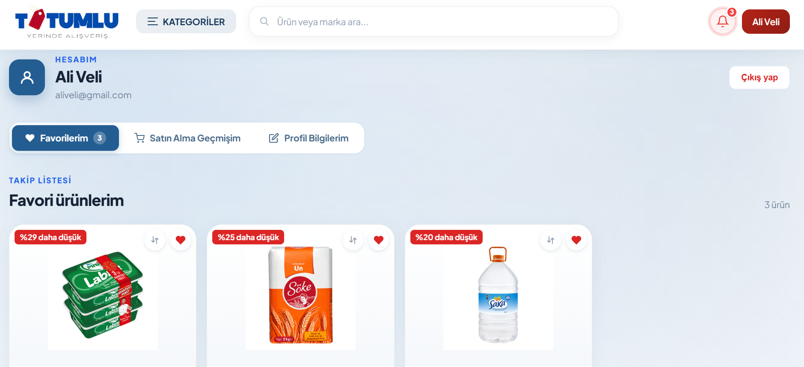

# 🏷️ Tutumlu - Akıllı Market Fiyat Karşılaştırma & Takip Platformu

<div align="center">



[](https://dotnet.microsoft.com/)
[](https://learn.microsoft.com/dotnet/csharp/)
[](https://www.elastic.co/)
[](https://www.microsoft.com/sql-server)
[](https://redis.io/)
[](https://playwright.dev/)
[](https://www.docker.com/)

**Tutumlu**, Türkiye'deki zincir market ve e-ticaret sitelerindeki (Migros, Macrocenter, Hakmar Express, A101, Teknosa, Evidea vb.) binlerce ürünü otomatik olarak tarayan, yapay zeka destekli akıllı eşleştirme motoruyla standartlaştıran ve en uygun fiyatı son kullanıcıya sunan modern bir fiyat karşılaştırma ve tasarruf platformudur.

[Özellikler](#-öne-çıkan-özellikler) • [Ekran Görüntüleri](#-ekran-görüntüleri) • [Mimari & Teknolojiler](#-mimari-ve-teknolojiler) • [Kurulum](#-hızlı-kurulum) • [API & Servisler](#-proje-yapısı)

</div>

---

## 📸 Ekran Görüntüleri

### 1. Ana Sayfa & Kampanyalar
Modern "Buz Mavisi" tasarım dili, öne çıkan kampanyalar, kategori navigasyonu ve anlık ürün vitrini.


---

### 2. Kategori & Dinamik Mağaza Filtreleme
Gelişmiş akordeon filtreler, anlık mağaza/market bazlı ürün sayaçları (Migros, Macrocenter, Hakmar, A101 vb.), fiyat aralığı seçici ve hızlı arama.


---

### 3. Çoklu Mağaza Fiyat Karşılaştırma & 30 Günlük Fiyat Geçmişi
Tek bir tıkla aynı ürünün farklı mağazalardaki anlık fiyatları, birim fiyatları (₺/kg), "En Ucuz" teklif rozeti ve son 30 günün fiyat değişim grafiği.


---

### 4. Kullanıcı Hesabı & İndirim Takibi (Favoriler)
Takip listesine alınan ürünlerdeki anlık fiyat düşüşleri ("%29 daha düşük"), tasarruf geçmişi ve bildirim yönetimi.


---

## ✨ Öne Çıkan Özellikler

- 🛒 **Çoklu Mağaza Entegrasyonu & Web Scraping**:
  - Migros, Macrocenter, Hakmar Express, A101, Teknosa, Evidea ve Market Fiyatı kaynaklarından otomatik ürün, kategori ve fiyat toplama.
  - Headless Chromium (Playwright) ve yüksek performanslı HTTP API istemcileri.
- 🧠 **Gelişmiş Eşleştirme Motoru (Matching Engine)**:
  - Farklı sitelerdeki farklı ürün başlıklarını standartlaştırma (Örn: `"Eker Yoğurt Süzme 500 G"` ile `"Eker Süzme Yoğurt 500gr"`).
  - Boyut & birim ayrıştırma (g, kg, ml, l, adet, paket, rulo).
  - Türkçe ek ve polarite uyuşmazlığı kontrolü (Örn: *şekerli* vs *şekersiz*, *yağlı* vs *yağsız* gibi zıt ürünlerin birbirine karışmasını engelleme).
- 📈 **30 Günlük Fiyat Geçmişi Analizi**:
  - Her ürün teklifi için kronolojik fiyat geçmişi kaydı ve interaktif Canvas fiyat grafiği.
- 🔍 **Elasticsearch 8 ile Ultra Hızlı Arama**:
  - Türkçe kök analizi, eşanlamlı (synonym) eşlemeleri, typo-tolerance ve gramaj aramaları (Örn: "500 ml su", "3 kg un").
- ⚡ **Redis Önbellekleme**:
  - Popüler kategoriler, en çok arananlar ve oturum yönetimi için yüksek hızlı cache katmanı.
- 🎨 **Modern & Şık Arayüz**:
  - Buz mavisi özel tema, CSS Değişkenleri, modüler Vanilla JS mimarisi, mobil uyumlu (responsive) düzen.
- 🔐 **Kullanıcı & Güvenlik Yönetimi**:
  - PBKDF2 tabanlı güvenli parola hashleme, JWT (JSON Web Token) kimlik doğrulama, güvenli çerez desteği.

---

## 🛠️ Mimari ve Teknolojiler

| Katman | Teknoloji / Kütüphane | Açıklama |
| :--- | :--- | :--- |
| **Backend API** | .NET 10 / ASP.NET Core Minimal APIs | Yüksek performanslı, asenkron RESTful servis mimarisi |
| **Veritabanı** | Microsoft SQL Server 2022 | İlişkisel veri modeli, fiyat geçmişi ve kategori ağaçları |
| **Arama Motoru** | Elasticsearch 8.13 | Türkçe analizörlü tam metin arama ve filtreleme |
| **Önbellek** | Redis (Alpine) | Dağıtık veri önbellekleme ve oturum katmanı |
| **ORM / Veri Erişimi** | Dapper | Yüksek verimli mikro-ORM sorguları |
| **Scraper & Parser** | Microsoft Playwright, HtmlAgilityPack | Tarayıcı otomasyonu ve HTML/JSON veri ayıklama |
| **Frontend** | Vanilla ES6+ JS, CSS3, FontAwesome | Sıfır harici JS bağımlılığı ile ultra hafif ve hızlı UI |
| **Konteynerizasyon** | Docker, Docker Compose | Tek komutla tüm altyapıyı ayağa kaldırma |

---

## 📁 Proje Yapısı

```
tutumlu/
├── PriceAggregator.Api/        # ASP.NET Core Web API & Frontend statik sunucusu
│   ├── Endpoints/              # Minimal API uç noktaları (Product, Store, Auth, vb.)
│   ├── Frontend/               # Modern arayüz dosyaları (HTML, CSS, JS modülleri)
│   └── Properties/             # Çalıştırma profilleri (launchSettings.json)
├── PriceAggregator.Core/       # Çekirdek iş mantığı, domain modelleri ve servisler
│   ├── Auth/                   # Kullanıcı, parola hashleme ve JWT işlemleri
│   ├── Categorization/         # Kategori ağacı ve varyant çözümleyiciler
│   ├── Matching/               # Akıllı ürün eşleştirme ve benzerlik motoru
│   ├── Pricing/                # Fiyat takibi ve birim hesaplama
│   ├── Scrapers/               # Market kazıyıcıları (Migros, A101, Hakmar vb.)
│   └── Search/                 # Elasticsearch indeksleme ve arama servisi
├── PriceAggregator.Scraper/    # Manuel veya tekil çalıştırma konsol uygulaması
├── PriceAggregator.Worker/     # Periyodik arka plan veri güncelleme servisi
├── docs/screenshots/           # Depo ekran görüntüleri
├── schema.sql                  # SQL Server veritabanı şeması ve indeksleri
├── seed_categories.sql         # Kanonik kategori tohumlama verileri
├── seed_seller_categories.sql  # Mağaza reyon eşleme tohumlama verileri
├── docker-compose.yml          # Tüm servisleri başlatan Compose konfigürasyonu
├── .env.example                # Örnek çevre değişkenleri
└── run.sh                      # Hızlı çalıştırma kabuk betiği
```

---

## 🚀 Hızlı Kurulum

### Gereksinimler
- [.NET 10 SDK](https://dotnet.microsoft.com/download/dotnet/10.0)
- [Docker Desktop](https://www.docker.com/products/docker-desktop/) (veya Docker Engine + Docker Compose)

---

### Yöntem 1: Docker Compose ile Tek Adımda Çalıştırma (Önerilen)

1. **Depoyu klonlayın:**
   ```bash
   git clone https://github.com/sema2357/Tutumlu.git
   cd Tutumlu
   ```

2. **Çevre değişkenlerini yapılandırın:**
   ```bash
   cp .env.example .env
   ```

3. **Veritabanı, Elasticsearch ve Redis servislerini başlatın:**
   ```bash
   docker compose up -d mssql init-db elasticsearch redis
   ```
   > `init-db` servisi SQL Server hazır olduğunda otomatik olarak veritabanını, tabloları ve kategori tohumlarını oluşturacaktır.

4. **API ve Arayüzü başlatın:**
   ```bash
   dotnet run --project PriceAggregator.Api
   ```

5. Tarayıcınızda açın:
   👉 **http://localhost:5196**

---

### Yöntem 2: Docker ile Tüm Sistemi (API & Worker Dahil) Çalıştırma

Tüm uygulamayı konteynerler içinde çalıştırmak için:
```bash
docker compose --profile app up -d --build
```
Uygulama `http://localhost:5196` adresinden yayında olacaktır.

---

### Veri Kazıma ve İndekslemeyi Başlatma

İstediğiniz zaman marketlerden güncel verileri çekmek ve Elasticsearch'ü doldurmak için:

```bash
# Tüm marketleri tarar ve ürünleri eşleştirir
dotnet run --project PriceAggregator.Scraper

# Veya periyodik arka plan servisini (Worker) başlatabilirsiniz
dotnet run --project PriceAggregator.Worker
```

---

## 🔒 Güvenlik & Konfigürasyon

Bu depo halka açık (public) olduğu için varsayılan şifreler temizlenmiştir:
- Yerel geliştirme için `appsettings.Development.json` dosyasını kullanabilir veya gizli bilgilerinizi `.env` dosyasında tanımlayabilirsiniz.
- Üretime alırken `.env` dosyasındaki `MSSQL_SA_PASSWORD`, `ELASTIC_PASSWORD` ve `JWT_SECRET` değerlerini güçlü anahtarlarla değiştiriniz.

---

## 📄 Lisans

Bu proje eğitim ve kişisel portfolyo amacıyla geliştirilmiştir. Tüm hakları saklıdır.
